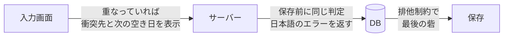

# マジスケとは？

身内デベロッパー（少人数の開発仲間）のための、**プロジェクトをまたいで**使えるスケジュール管理 Web アプリです。

たとえば minebook と nomiメモ を同時に開発していると、同じ人が両方のプロジェクトで同じ週にタスクを持っていても、ふつうのツールでは気づけません。ツールが1プロジェクトずつしか見ていないからです。マジスケは全プロジェクトのタスクを1か所にまとめて、「この人はこの日もう別のプロジェクトの作業がある」と保存の時点で止めます。

- 公開 URL：https://mergecalschedule.vercel.app/
- 初版の公開：2026-11-19（木）20:00

ちなみに名前は「マージ（merge）」と「スケジュール」を掛けて、マージカルスケジュール、略してマジスケです。

## できること

- 複数プロジェクトの作成とメンバー招待
- WBS（目的 ＞ フェーズ ＞ タスク）の編集
- ガントチャートとイナズマ線（進捗管理日に、遅れ・先行が線の曲がりで分かる）
- メンバーボード：1人1枚のカードで「誰が今何をしていて、遅れ・困りごとがあるか」が1画面で分かる
- 困りごと（ヘルプ）の共有
- 週次の提出物の出力：工程表（xlsx）と進捗レポート（PDF）

チャット、ファイル置き場、工数・金額の管理、通知、外部カレンダー連携は作りません（Discord などの既存ツールに任せます）。

## こだわり：WBS のルールを「人の注意」ではなく「仕組み」で守る

授業で教わった「WBS 作成チェックポイント」を、入力した時点でアプリが強制します。うっかりルールを破った計画は、そもそも保存できません。

| # | ルール | アプリでの扱い | 強さ |
|---|---|---|---|
| 0 | 稼働日は平日だけ | 土日祝は開始日・終了日に選べない。期間・進捗・バッファはすべて稼働日で数える | 保存不可 |
| 1 | タスクは成果物の単位で作る | 「成果物」は必須。完了にするには成果物の URL かメモが必要 | 保存不可 |
| 2 | 1タスクの担当者は1人 | 担当者は1人だけ選べる。「全員」はない。「メンバー分複製」で人数分のタスクに分ける | 保存不可 |
| 3 | 1人が2つ以上のタスクを同時に持たない | 同じ人の予定期間が重なると保存できない。**全プロジェクトをまたいで判定する** | 保存不可 |
| 4 | 締切日ぴったりに終わる計画にしない | 締切日とバッファ日数はプロジェクトごとに入力。バッファに食い込むと赤で警告 | 警告 |
| 5 | 週1回、進捗を共有する | 週の最終曜日に進捗共有日を表示し、工程表と進捗レポートを出力できる | 表示＋出力 |

### いちばん大事なルール3を、3重で守る

「同じ人のタスクの期間が重ならない」は、このアプリの存在理由なので、1か所ではなく3か所で止めます。



| どこで | どうやって | 何のため |
|---|---|---|
| 画面 | 入力中に重なりを調べ、衝突するタスク（プロジェクト名・タスク名・期間）と「次の空き日」を出す | 使う人がすぐ直せるように |
| サーバー | 保存する前に同じ関数で判定し、重なっていれば日本語のエラーを返す | 画面を通らない操作も止める |
| DB | PostgreSQL の排他制約（`EXCLUDE USING gist`）で、同じ担当者の期間の重なりを拒否する | 同時に保存されても、すり抜けさせない |

```sql
CREATE EXTENSION IF NOT EXISTS btree_gist;
ALTER TABLE tasks ADD CONSTRAINT no_parallel_tasks
  EXCLUDE USING gist (
    assignee_id WITH =,
    daterange(planned_start, planned_end, '[]') WITH &&
  );
```

タスクは全プロジェクト共通の1つの表に入れています。だから DB がプロジェクトをまたいで重なりを判定できます。

### 判定は1か所に書く

ルールの判定は、画面ごとに書き直さず、`src/lib/` の純粋関数（入力が同じなら結果も必ず同じ関数）にまとめます。画面・サーバー・テストのどこからも同じ関数を呼ぶので、「画面では通ったのにサーバーで弾かれた」というずれが起きません。

## いまの状態

開発計画書の WBS（12タスク）に沿って進めています。

- [x] 要件確定
- [x] 環境構築・認証（メール＋パスワードでログイン、日本語 PDF の試作）
- [x] DB 設計（R0〜R4 の制約入りマイグレーション、`pnpm db:check` で確認）
- [x] ルール判定・テスト（稼働日計算、R0〜R5、遅れ判定・イナズマ線。Vitest）
- [x] プロジェクト・招待（招待リンクからだけ登録できる。メンバーでないプロジェクトは見えない）
- [x] WBS 編集（3階層の表、ルールチェック欄、並列禁止をプロジェクト横断で入力中に表示）
- [x] ガントチャート＋イナズマ線（予定・実績バー、予備期間の帯、進捗管理日の切り替え）
- [x] メンバーボード（全プロジェクト横断の今日のタスク・遅れ・空き、自分のタスクの進捗更新）
- [ ] 困りごと
- [ ] 工程表 xlsx 出力
- [ ] 進捗レポート PDF 出力
- [ ] 結合テスト（minebook・nomiメモを登録して主要な流れを通す）

ダッシュボードと個人タイムラインは第2版（11/20 以降）で作ります。

## 技術スタック

| 用途 | 使用技術 |
|---|---|
| フレームワーク | Next.js 16（App Router）+ TypeScript（strict） |
| DB | Neon Postgres（排他制約で並列禁止を保証するため Postgres を選択） |
| ORM / マイグレーション | Drizzle ORM + drizzle-kit |
| 認証 | Better Auth（メール＋パスワード。ユーザー表を自分の DB に持つ） |
| UI | Tailwind CSS v4 + shadcn/ui |
| ガントチャート | 自作（CSS Grid + SVG。イナズマ線と予備期間の帯を自由に描くため） |
| xlsx 出力 | ExcelJS |
| PDF 出力 | @react-pdf/renderer + Noto Sans JP（`public/fonts/` に同梱） |
| 祝日判定 | @holiday-jp/holiday_jp |
| テスト | Vitest（ルール判定）+ Playwright（主要な流れ） |
| CI | GitHub Actions（lint・型チェック・テスト・ビルド） |
| ホスティング / CD | Vercel（関数は Neon と同じシンガポールで動かす） |

## 動かし方

Node.js 24、pnpm 12 で確認しています。

```bash
pnpm install
cp .env.example .env.local
```

`.env.local` に次の値を入れます。

| 変数 | 中身 |
|---|---|
| `DATABASE_URL` | Neon の接続文字列（Connection pooling を ON にしたもの。ホスト名に `-pooler` が付く） |
| `DATABASE_URL_UNPOOLED` | Neon の接続文字列（Connection pooling を OFF にしたもの。マイグレーション用） |
| `BETTER_AUTH_SECRET` | `openssl rand -base64 32` で作ったランダムな文字列 |
| `BETTER_AUTH_URL` | `http://localhost:3000`（本番では公開 URL） |

DB にテーブルを作ってから、開発サーバーを起動します。

```bash
pnpm db:migrate
pnpm dev
```

http://localhost:3000 を開くとログイン画面が出ます。ユーザーがまだ1人もいないときだけ、ここで最初の1人を登録できます。2人目からは、プロジェクトの設定画面で作った招待リンクから登録します。

| コマンド | 内容 |
|---|---|
| `pnpm dev` | 開発サーバーを起動 |
| `pnpm build` | 本番ビルド |
| `pnpm lint` | コード解析 |
| `pnpm typecheck` | 型チェック |
| `pnpm test` | ルール判定のテスト（Vitest）を1回実行 |
| `pnpm test:watch` | 変更を監視してテスト |
| `pnpm db:generate` | `src/db/schema.ts` の変更からマイグレーションを作る |
| `pnpm db:migrate` | マイグレーションを DB に適用する |
| `pnpm db:check` | DB の制約（R0〜R4）が効いているかを確かめる（ロールバックするのでデータは残らない） |

DB のスキーマを変えたら、必ず `pnpm db:generate` でマイグレーションを作り、SQL を読んで確かめてから `pnpm db:migrate` します。本番の DB に直接 `push` はしません。

## ディレクトリ構成

```
src/
  app/
    login/          ログイン（最初の1人だけここで登録）
    invite/[token]/ 招待の受諾（招待から登録・参加）
    (app)/          ログイン後の画面（サイドバー付きの共通レイアウト）
      board/        チームボード（いまは仮）
      projects/     プロジェクト一覧・作成・設定（招待・役割）、WBS 編集
    api/auth/       Better Auth の API
    api/pdf-test/   日本語 PDF の確認用（PDF 出力の本実装で置き換える）
  components/
    common/         画面共通の部品（ProjectTile・Field・RuleAlert・ボタンなど）
    shell/          サイドバー・ヘッダー
    projects/       プロジェクトのフォーム
    wbs/            WBS 編集（表・タスク編集モーダル・ルールチェック欄）
    gantt/          ガントチャート（日付グリッド・バー・イナズマ線の SVG）
    ui/             shadcn/ui の部品
  db/
    schema.ts       Drizzle のスキーマ
    migrations/     drizzle-kit で作ったマイグレーション
  lib/
    auth/           Better Auth の設定、ログイン必須・プロジェクトの権限チェック
    invitations/    招待の期限・入力チェック
    format/         日付・日数の表示（11/19（木）、n稼働日）
    wbs/            WBS の並べ替え・ルールチェック欄（純粋関数）、読み込みと並列チェック（server.ts）
    gantt/          ガントの表示範囲・バー・イナズマ線の頂点（純粋関数）、読み込み（server.ts）
    calendar/       稼働日の計算（R0）：isWorkday、workdaysBetween、addWorkdays など
    rules/          WBS ルールの判定（R0〜R5）：重なり・次の空き日・バッファ・ファイル名
    progress/       遅れ判定・イナズマ線・メンバーカード用の計算
    project-style/  プロジェクトの6色とアイコン（画面デザインのトークン）
    export/         xlsx / PDF の生成（いまは日本語フォントの登録だけ）
  proxy.ts          未ログインならログイン画面へ送る
tests/unit/         Vitest（calendar・rules・progress）
scripts/            DB 制約の確認スクリプト
public/fonts/       PDF 用の日本語フォント（Noto Sans JP）
docs/               開発計画書、画面デザイン（SCREENS.md）、開発記録
```

## CI

GitHub Actions で、プルリクエストと main への push のたびに、lint・型チェック・テスト・ビルドを実行します（[.github/workflows/ci.yml](.github/workflows/ci.yml)）。

## 開発の進め方

- 計画書の WBS の1タスクにつき、ブランチ1本・プルリクエスト1つ
- タスクの成果物ができたら止まって報告し、マージしてから次のタスクへ
- ルール判定（`lib/rules`、`lib/progress`、`lib/calendar`）を変えたら、Vitest のテストを足して全件パスさせる

設計の詳細と開発スケジュールは [docs/マジスケ開発計画書.md](docs/マジスケ開発計画書.md) にまとめています。
